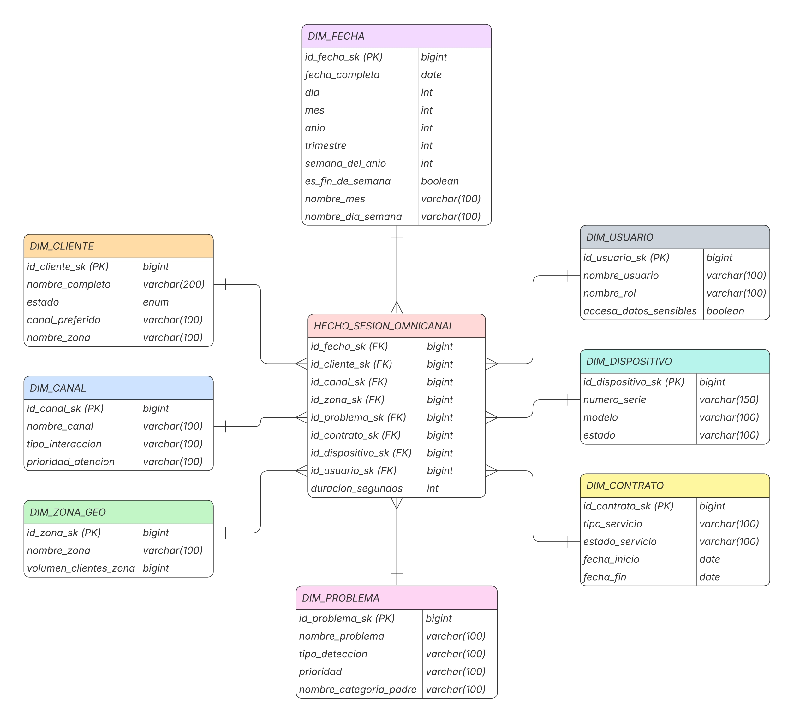

# Schaman Analytics — Data Warehouse y dashboard omnicanal

## Integrantes

- **Paula Martillo Quintana** — diseño e implementación de la interfaz.
- **Daniel Vaca Velastegui** — proceso ETL con Pentaho PDI.
- **Leonor Molina Zapata** — funciones SQL/RPC.
- **Raúl Garay Vinueza** — proceso ETL con Pentaho PDI.

## Descripción

Schaman Analytics es una solución de Business Intelligence para **Schaman S.A.** Cubre todo el recorrido de los datos: desde el diseño de un Data Warehouse con modelo dimensional hasta un dashboard web que consulta ese almacén y muestra los indicadores del centro de resolución omnicanal.

## Objetivo del proyecto

Diseñar, implementar y consumir un Data Warehouse que integre, consolide y organice la información del centro de resolución omnicanal de Schaman. Así se puede analizar cómo ha evolucionado la atención a lo largo del tiempo y respaldar decisiones estratégicas con datos: qué canales resuelven mejor, qué problemas generan más contactos y qué dispositivos fallan con más frecuencia.

## Herramientas

| Capa | Herramienta |
| --- | --- |
| Base de datos y Data Warehouse | PostgreSQL alojado en [Supabase](https://supabase.com) |
| Proceso ETL | Pentaho Data Integration (PDI) para extraer, limpiar, transformar y cargar los datos desde la base OLTP al Data Warehouse |
| Capa lógica | Funciones RPC en SQL que reciben los filtros y calculan cada indicador |
| Frontend | React 19 + Vite 8 |
| Estilos | Tailwind CSS 4 y un sistema de diseño propio con variables CSS (`src/index.css`) |
| Gráficos | Recharts 3 |
| Íconos | Lucide React |
| Tipografía | Bricolage Grotesque (títulos y cifras) y Figtree (texto), desde Google Fonts |
| Cliente de datos | `@supabase/supabase-js` |

## Modelo dimensional

El Data Warehouse usa un **modelo estrella**. La tabla de hechos `HECHO_SESION_OMNICANAL` tiene una fila por cada sesión de atención y se relaciona con ocho dimensiones: `DIM_FECHA`, `DIM_CLIENTE`, `DIM_CANAL`, `DIM_ZONA_GEO`, `DIM_PROBLEMA`, `DIM_CONTRATO`, `DIM_DISPOSITIVO` y `DIM_USUARIO`.



## Indicadores

El dashboard consulta el Data Warehouse con los filtros que elige el usuario (año, mes, canal, región y zona) y calcula:

1. **FCR (resolución al primer contacto):** porcentaje de sesiones resueltas en la primera interacción.
2. **TMO (tiempo medio de operación):** duración promedio de las sesiones.
3. **T-NPS (satisfacción del cliente):** porcentaje de promotores menos porcentaje de detractores.
4. **Tasa de éxito:** porcentaje de sesiones que terminaron resueltas.
5. **Resolución por IA:** porcentaje de sesiones marcadas como resueltas por inteligencia artificial.
6. **Score global:** métrica compuesta sobre 500 puntos que suma cinco dimensiones de 0 a 100.

## Páginas del dashboard

### Panel general

Es la vista de entrada y va de lo general a lo particular. Arriba están los filtros. Debajo aparece el **score global**, con su nivel (Básico, Intermedio, Avanzado o Excelente) y el detalle de sus cinco dimensiones: precisión, efectividad, eficiencia, experiencia y resolución por IA. Después vienen las tarjetas de los cinco KPIs y, al final, tres gráficos: la evolución mensual de FCR y TMO, la distribución de sesiones por canal y la tasa de éxito por zona.

### Análisis de fallos

Se centra en los problemas que generan contactos. Usa los mismos filtros que el panel general y muestra cuatro indicadores: total de sesiones con fallo, problema más frecuente, el peso de ese problema sobre el total y la tasa de resolución frente a la meta del 75 %. Incluye el top 10 de problemas coloreado por prioridad, la distribución por categoría, una tabla de resolución por prioridad y un gráfico de fallos por modelo de dispositivo coloreado según su tasa de fallo.

### Sesiones

Es el nivel más detallado: una tabla con las sesiones más recientes según los filtros aplicados. Para cada sesión muestra el cliente, el canal, la zona, la duración, si se resolvió al primer contacto, si la resolvió la IA y la calificación NPS junto con su categoría (promotor, pasivo o detractor).

### Datos y metodología

Explica de dónde salen los números. Resume el flujo de los datos (base de datos → Pentaho → Data Warehouse → funciones SQL → panel), describe el modelo analítico, señala los límites conocidos de los datos y define cómo se calcula cada indicador y el score global.

## Rediseño de la interfaz

La primera versión del dashboard ya funcionaba con datos reales, pero cada tarjeta tenía su propio color, los textos eran pequeños y algunos gráficos eran difíciles de leer. Por eso rediseñamos la interfaz tomando como referencia dashboards financieros y de analítica actuales. Los principales cambios fueron estos:

- **Una paleta consistente.** Un solo color de marca (teal) para la interfaz. Los colores de los gráficos salen de una paleta de ocho tonos validada para personas con daltonismo, y cada entidad conserva su color en todo el dashboard: un canal se ve igual en el donut y en la tabla. El verde, el ámbar y el rojo quedan reservados para comunicar estados (bueno, en riesgo, crítico) y siempre van acompañados de texto o de una leyenda.
- **Textos más grandes y jerarquía clara.** Títulos de página más grandes, cifras destacadas y etiquetas legibles en tablas y ejes.
- **Gráficos más honestos.** FCR y TMO se mostraban en un mismo gráfico con dos ejes, lo que podía sugerir relaciones que no existen; ahora son dos gráficos sincronizados que comparten el eje de meses. Las barras empiezan en cero y los gráficos que miden una sola cosa usan un solo color.
- **Navegación más simple.** Un menú lateral con el logo y los nombres de cada sección, que se puede contraer. La tabla de sesiones pasó a su propia página y se agregó la página de metodología.
- **Accesibilidad.** Filtros con etiquetas, foco visible al navegar con teclado y respeto por la preferencia de reducir animaciones.

### Antes y después

**Panel general — antes**


**Panel general — después**


**Análisis de fallos — antes**


**Análisis de fallos — después**


**Sesiones — antes** (estaba al final del panel general)


**Sesiones — después**


**Datos y metodología** (página nueva)


## Cómo ejecutar el proyecto

1. Instala las dependencias:

   ```bash
   npm install
   ```

2. Crea un archivo `.env` en la raíz con las credenciales del proyecto de Supabase:

   ```bash
   VITE_SUPABASE_URL=https://<tu-proyecto>.supabase.co
   VITE_SUPABASE_ANON_KEY=<tu-clave-anon>
   ```

3. Levanta el servidor de desarrollo y abre la URL que aparece en la terminal:

   ```bash
   npm run dev
   ```

Para generar la versión de producción usa `npm run build`.

## Estructura del código

```
src/
├── App.jsx              # Layout y navegación entre páginas
├── index.css            # Sistema de diseño: colores, tipografía y componentes base
├── lib/
│   ├── supabase.js      # Cliente de Supabase
│   └── chartTheme.js    # Paleta y estilos compartidos por todos los gráficos
├── hooks/               # Consultas a las funciones RPC (panel, fallos y filtros)
├── components/          # Tarjetas, gráficos, filtros, tabla y menú lateral
└── pages/               # Análisis de fallos, Sesiones, Datos y metodología
```
